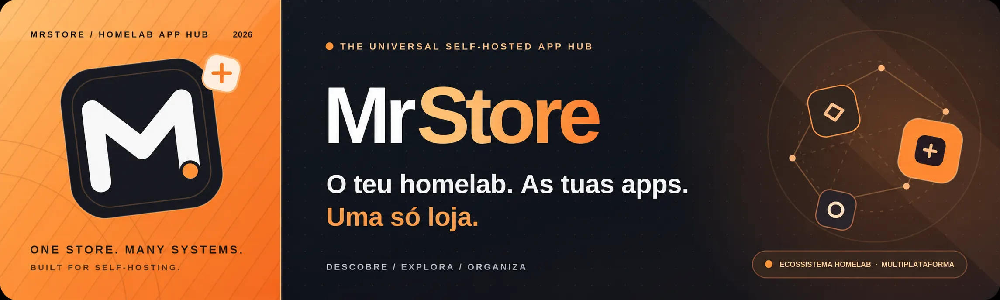

<div align="center">
  

  <h1>MrStore · The Homelab App Hub</h1>

  <p><strong>O teu homelab. As tuas apps. Uma só loja.</strong><br>Descobre aplicações self-hosted num catálogo comunitário para servidores e NAS. Consulta aplicações no navegador, usa o formato ZimaOS v2 quando adequado ou prepara manualmente os manifestos Docker Compose.</p>

  <p>
    <a href="https://mrpiracy94.github.io/"><strong>🌐 Explorar a loja</strong></a>
    &nbsp; · &nbsp;
    <a href="#-plataformas-e-compatibilidade"><strong>📦 Formatos disponíveis</strong></a>
    &nbsp; · &nbsp;
    <a href="#-segurança-e-transparência"><strong>🛡️ Segurança</strong></a>
    &nbsp; · &nbsp;
    <a href="https://github.com/mrpiracy94/MrStore/issues"><strong>💬 Issues e sugestões</strong></a>
  </p>
</div>

---

## ✨ O que é a MrStore?

A **MrStore** reúne **254 aplicações self-hosted** para servidores, NAS e homelab num único inventário `Apps/`. A montra permite pesquisar e consultar aplicações; a distribuição técnica usa o formato **ZimaOS App Store v2**. Uma entrada no catálogo não prova instalação funcional num equipamento real nem ausência de vulnerabilidades.

**A montra web funciona num navegador, mas não instala aplicações.** Esta edição não anuncia integração nativa com sistemas que ainda não foram validados.

| 🔍 Exploração fácil | 📦 Aplicações self-hosted | 🛡️ Segurança por aplicação |
|:---|:---|:---|
| Pesquisa por nome, categoria, arquitetura e favoritos na montra web. | Inventário completo das apps em `Apps/`, com IDs estáveis. | Auditorias CVE e de configurações separadas da listagem editorial. |

**[Abrir a montra da MrStore →](https://mrpiracy94.github.io/)**

> **Nota:** a montra em GitHub Pages permite descobrir aplicações e consultar o catálogo real, mas não instala contentores. Só considera uma edição validada quando os relatórios da publicação correspondem ao índice apresentado.

## 🌍 Plataformas e compatibilidade

**Consultar o catálogo não significa poder adicionar esta loja a qualquer sistema.**

| Funcionalidade | Disponibilidade | Limites |
|:---|:---|:---|
| **Montra web** | Disponível | Pesquisa, favoritos, categorias e fichas num navegador; não instala contentores. |
| **ZimaOS App Store v2** | Catálogo técnico gerado e publicado | Instalação, configuração e atualização exigem validação real por versão, dispositivo e aplicação. |
| **Docker Compose** | 254 manifestos-fonte em `Apps/` | Para consulta e implantação manual após rever permissões, portas, volumes e segredos. |

As integrações não funcionais foram retiradas da apresentação e da publicação. Uma nova integração apenas deverá ser anunciada quando existirem formatos utilizáveis e testes reais.

📖 [Guia ZimaOS](docs/ZIMAOS_INSTALLATION.md) · [Ensaios em equipamento](docs/ZIMAOS_COMPATIBILITY.md) · [Segurança](SECURITY.md)

## ⭐ Catálogo completo — 254 aplicações

A MrStore apresenta **todas as aplicações com manifestos em `Apps/`**, incluindo Home Assistant, Jellyfin, Immich, Nextcloud, qBittorrent e Vaultwarden. As futuras adições entram automaticamente na publicação editorial quando os respectivos manifestos e metadados forem válidos.

- **Loja técnica ZimaOS v2:** https://mrpiracy94.github.io/MrStore/
- **Homepage e pesquisa:** https://mrpiracy94.github.io/
- **Website separado:** https://mrpiracy94.github.io/MrStore-Web/ (requer ativação GitHub Pages neste repositório)

A listagem não filtra apps com avisos CVE. O ficheiro `release-status.json` apresenta `certification: not_assessed` nas edições editoriais; as auditorias continuam independentes da descoberta.

## 🧭 Descobrir aplicações

A montra web permite consultar aplicações sem anunciar suporte nativo por validar:

- **Pesquisar** por nome, descrição e categoria.
- **Filtrar** por categoria e arquitetura AMD64/ARM64.
- **Guardar favoritos** localmente no navegador, sem criar conta.
- **Consultar fichas** com a versão do pacote, serviço e link para o manifesto Docker.
- **Distinguir publicação verificada de edições antigas**, com alertas caso o relatório de seleção segura esteja ausente.

Para consultar os manifestos e configurações de todas as aplicações, abre a pasta [Apps/](Apps/).

## 🛡️ Segurança e transparência

A **publicação editorial** inclui todas as aplicações, independentemente do resultado CVE. Uma edição editorial não é uma certificação de instalação ou segurança.

As **auditorias técnicas opcionais para releases verificados** continuam a analisar imagens Docker, arquitetura, digests e configurações. Os seus relatórios identificam riscos, sem apagar apps da montra. Uma edição técnica filtrada não pode substituir o catálogo completo por uma seleção menor.

**Não afirmamos ausência de CVEs.** Antes de instalar, confirma os requisitos, credenciais, permissões e dependências da aplicação.

📖 [Política de publicação segura](docs/SAFE_RELEASE_POLICY.md) · [Validação técnica](docs/ZIMAOS_COMPATIBILITY.md) · [Avisos de segurança](SECURITY.md)

## ⚙️ Tecnologias e automação

| Componente | Finalidade |
|:---|:---|
| **Builder ZimaOS v2** | Exportação para o formato de loja externa atualmente integrado. |
| **Docker Compose** | Definir as aplicações, serviços, volumes e portas. |
| **Python + PyYAML** | Validar metadados, arquiteturas, segurança e catálogos. |
| **Trivy + crane** | Auditar vulnerabilidades e consultar digests das imagens. |
| **GitHub Actions** | Verificações, testes de regressão, monitorização e publicação. |
| **HTML + CSS + JavaScript** | Montra leve e responsiva no GitHub Pages, sem dependências CDN. |

## 🗂️ Estrutura do projeto

```text
MrStore/
├── Apps/                 # Manifests de todas as apps listadas na MrStore
├── web/                  # Montra e recursos visuais GitHub Pages
│   ├── index.html
│   └── assets/
├── scripts/              # Validação, auditoria CVE, publicação e monitorização
├── security/images/      # Imagens de segurança corrigidas quando justificadas
├── tests/                # Testes offline e regressões
├── docs/                 # Guias, política de segurança e migrações
├── .github/workflows/    # Validação CI, publicação e verificações programadas
├── category-list.json
├── recommend-list.json
└── store-config.json
```

## 🧪 Desenvolvimento e testes

```bash
python -m pip install -r requirements.txt
python scripts/validate.py
python -m unittest discover -s tests -v
python scripts/compatibility.py
```

A homepage pública é mantida em [`mrpiracy94.github.io`](https://github.com/mrpiracy94/mrpiracy94.github.io) e sincroniza automaticamente **todos os manifests** da MrStore. O catálogo técnico em `gh-pages` é publicado separadamente com o inventário completo e a indicação `not_assessed` nas edições editoriais; não altera os Compose instalados nos servidores.

📖 [Como funciona a montra](docs/STORE_FRONTEND.md) · [GitHub Actions](https://github.com/mrpiracy94/MrStore/actions) · [Guia de integração](docs/ZIMAOS_INSTALLATION.md)

---

<div align="center">
  <strong>MrStore</strong> · Feita para a comunidade, com paixão por self-hosting. 🧡<br>
  <sub>Projeto comunitário independente, sem afiliação aos fabricantes das plataformas ou aos autores das aplicações.</sub>
</div>
